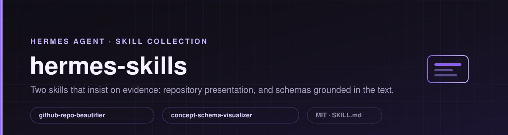

# hermes-skills




Agent skills for [Hermes Agent](https://hermes-agent.nousresearch.com/), written while they were needed. Each one
encodes a workflow that failed at least once before it got written down — the failure mode is part of the skill.

Both skills share one rule: **a claim about the work is not the work.** A repository is not "presented" until the
public rendering is read back, and a causal arrow is not "drawn" until it carries a quotation from the source text.

---

## What is inside

| Skill | Triggers when | What it actually does |
|---|---|---|
| **[github-repo-beautifier](skills/github-repo-beautifier/)** | A repository needs a README, artwork, metadata or a shareable page | Reads the real project, then builds a product-page rhythm: hero banner, functional badges, original SVG assets, navigation, honest scope. Refuses fictitious CI badges and empty sections; verifies the published rendering at desktop and mobile widths before claiming success |
| **[concept-schema-visualizer](skills/concept-schema-visualizer/)** | A dense text (philosophy, methodology, legal argument) needs a diagram | Semantic analyser, not an illustrator: it classifies the intellectual operation first, then emits a schema package. Every causal arrow must carry a `basis` field quoting the text; the engine warns about invented causality. Pure-stdlib Python, exports SVG/HTML, Obsidian Canvas and Excalidraw |

Two skills is deliberate. This collection grows only when a workflow has been used, broken and fixed — not when a
prompt looks plausible.

## Install

```bash
git clone https://github.com/AzamatSafarov/hermes-skills.git
cp -r hermes-skills/skills/* ~/.hermes/skills/
```

Hermes picks skills up on the next session; no build step, no dependencies for either skill.

## Verify it works

The schema engine ships with a demo spec and a self-contained renderer, so you can check the claim above:

```bash
cd skills/concept-schema-visualizer
python scripts/render_schema.py examples/demo-spec.json -o demo-out.html
```

Expected output — five schemas plus grounding warnings for arrows that have no `basis`:

```
WARN: schema[2]: причинная связь «норма» без grounding-поля basis
...
OK: demo-out.html (5 схем)
```

Open `demo-out.html` in a browser, or compare against the committed `examples/demo.html`.

## Structure

```
hermes-skills/
├── assets/hero.svg
├── skills/
│   ├── github-repo-beautifier/
│   │   ├── SKILL.md
│   │   └── references/          # full worked example, HTML footer snippet
│   └── concept-schema-visualizer/
│       ├── SKILL.md
│       ├── scripts/render_schema.py
│       └── examples/            # spec, rendered HTML, Canvas, Excalidraw
└── LICENSE
```

Each skill also has a standalone repository where its artwork and history live:
[github-repo-beautifier](https://github.com/AzamatSafarov/github-repo-beautifier) ·
[concept-schema-visualizer](https://github.com/AzamatSafarov/concept-schema-visualizer).

## Design rules both skills follow

- **Read back before reporting.** A successful write is not a published result: re-read the commit SHA, the rendered page, the file hash.
- **No invented evidence.** No placeholder CI badges, no fabricated metrics, no arrows without a quoted basis.
- **Ask before touching scope.** A presentation request is not permission to publish unrelated code or data.
- **Say what is unverified.** Every README in this collection marks the difference between "checked" and "assumed".

## Roadmap

The next bundles in this collection are academic toolchains, being extracted from real submission work:

- Academic submission toolkit — SSRN / Ledger / arXiv formatting and venue fit, from actual submission cycles
- Manuscript QA pack — pre-submission review passes: quality gates, reference verification, repetition and clarity

They will ship here once they survive the same test as the two above: used on a real manuscript, broken, then fixed.

## License

MIT — see [LICENSE](LICENSE). Copyright (c) 2026 Azamat Safarov.
